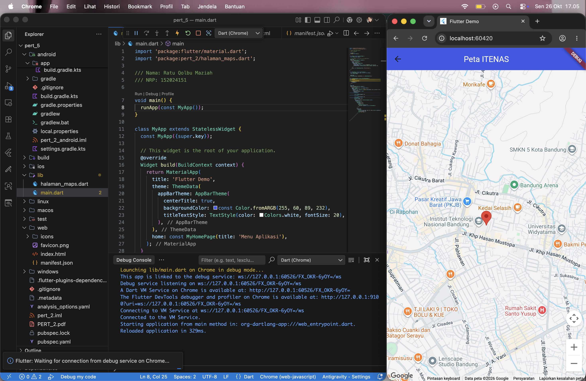
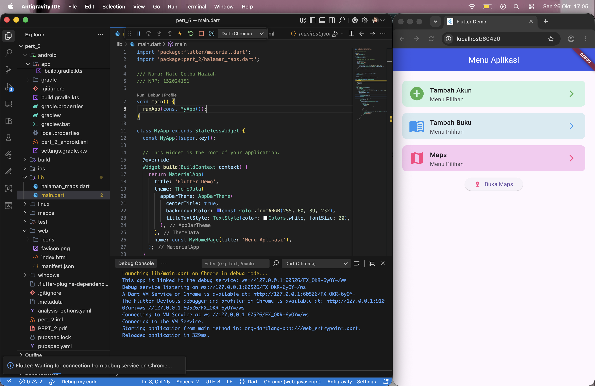

# pert_5

Proyek praktikum Pemrograman Mobile menggunakan Flutter untuk menampilkan menu aplikasi dan peta lokasi Institut Teknologi Nasional Bandung (ITENAS).

**Nama:** Ratu Qolbu Maziah  
**NRP:** 152024151

## Fitur

- Menu Tambah Akun dan Tambah Buku (tampilan menu).
- Navigasi ke halaman Maps melalui menu Maps atau tombol Buka Maps.
- Google Maps dengan marker lokasi kampus ITENAS.

## Screenshot

### Peta ITENAS



### Menu Aplikasi



## Menjalankan proyek

1. Instal Flutter dengan Dart yang memenuhi versi pada `pubspec.yaml`.
2. Ganti placeholder `[GCP_API_KEY]` di `web/index.html` dengan API key Google Maps untuk web.
3. Jalankan:

   ```sh
   flutter pub get
   flutter run -d chrome
   ```

Nama package Dart pada proyek ini adalah `pert_2`, sedangkan nama repositorinya adalah `pert_5`.
